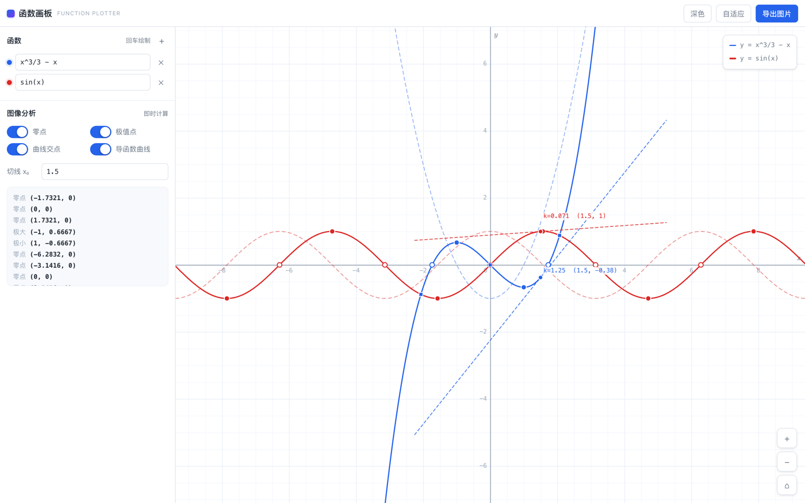
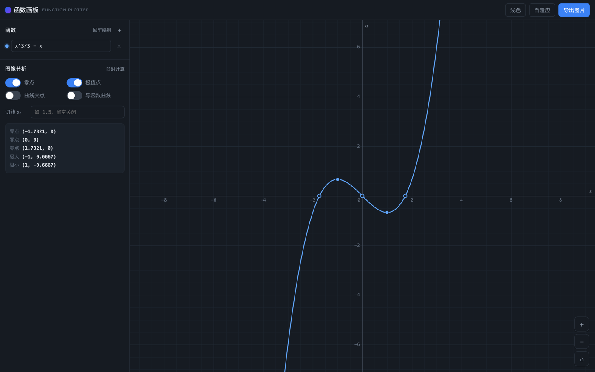
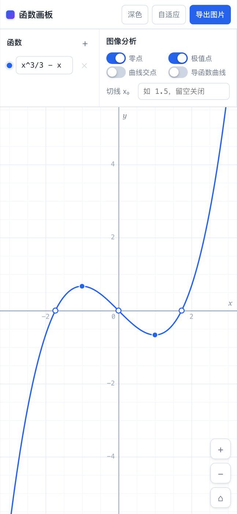

# 函数画板 · Function Plotter

一个**只做函数图像与图像分析**的在线画板。零依赖，单文件，打开即用。

输入 `x^3/3 - x`，它告诉你零点在哪、极值在哪、拐点处切线多陡——不需要装任何东西，不需要注册账号。



---

## 为什么还做这个

市面上不缺绘图工具，缺的是**不塞东西的工具**。

这个项目只有一个目标：把「画函数」和「分析函数」这两件事做到位，其余一概不做。没有 3D、没有概率统计、没有 AI 对话、没有云同步。整个应用 **57 KB**，一个 `<script>`，没有构建步骤，没有 npm 依赖，没有后端。

你可以把它当一个教学工具，也可以把 `Expr` 引擎单独抠出来塞进自己的项目——那部分只依赖 `Math`。

## 功能

**绘图**
- 多条曲线（最多 8 条），各自独立配色与显隐
- 滚轮 / 双指缩放，拖拽平移，一键自适应
- 网格步长按缩放级别自动选取 1 / 2 / 5 × 10ⁿ
- 悬停显示坐标读数

**图像分析**（全部为数值计算，非拟合）
- **零点**：变号扫描 + 二分法精化
- **极值点**：局部极值扫描 + 黄金分割精化
- **曲线交点**：两两构造差函数后求根
- **导函数曲线**：中心差分
- **指定点切线**：数值导数 + 点斜式

**其他**
- 深色 / 浅色主题，跟随系统
- 导出 PNG（2× 超采样）
- 响应式布局，手机上可用

<p>


</p>

## 表达式语法

| 类别 | 支持内容 |
|---|---|
| 运算符 | `+` `-` `*` `/` `^` `( )` |
| 隐式乘法 | `2x`、`3sin(x)`、`(x+1)(x-1)`、`x(x+2)` |
| 三角 | `sin` `cos` `tan` `asin` `acos` `atan` `atan2` |
| 双曲 | `sinh` `cosh` `tanh` |
| 指数对数 | `exp` `ln` `log`（常用对数）`log2` `sqrt` `cbrt` `pow` |
| 取整与符号 | `abs` `floor` `ceil` `round` `trunc` `sign` `fract` |
| 多参数 | `min(a,b)` `max(a,b)` `mod(a,b)` `sgn(x,p)` |
| 常量 | `pi` `tau` `e` |
| 阶跃 | `step(x)`（x ≥ 0 时为 1，可用来截取区间） |

符号会自动归一化，下面这些可以直接粘贴进来：

```
x²        →  x^2
（x+1）   →  (x+1)
x×2÷3     →  x*2/3
π         →  pi
√x        →  sqrt(x)
```

**渐变线示例**：`1/(1+exp(-8x))`、`sin(1/x)*x`、`x*sin(1/x)`、`tan(x)`

## 快捷键

| 按键 | 作用 |
|---|---|
| `F` | 自适应视图 |
| `R` | 回到原点 |
| `+` / `-` | 缩放 |

## 本地运行

```bash
# 方式一：直接打开
open index.html

# 方式二：起个静态服务（推荐，避免 file:// 的存储限制）
python3 -m http.server 8000
# 然后访问 http://localhost:8000
```

## 部署到 GitHub Pages

1. 仓库 → Settings → Pages
2. Source 选 `Deploy from a branch`，分支 `main`，目录 `/ (root)`
3. 稍等片刻，访问 `https://<你的用户名>.github.io/function-plotter/`

无需任何构建配置。改完 `index.html` 推上去就生效。

## 测试

```bash
node tests/engine.test.js
```

106 项断言，覆盖表达式解析、符号归一化、视口变换、采样断点、求根、求极值、求交、数值微分。可直接用系统 Node，无需安装任何依赖。

其中两条是重点回归：

- `1/x` 在原点附近符号翻转，**不得**被误判为零点
- `tan(x)` 的每条渐近线都必须把曲线切成独立分支，**不得**连成竖线

## 设计边界

以下限制是**有意为之**，不是没做完：

- 只支持单变量 `x`。不支持参数方程、极坐标、隐函数 `f(x,y)=0`
- 不做符号求导，全部走数值方法
- 不做动画（没有动点、没有描迹）
- 不做文件保存 / 分享链接（刷新即重置）

如果你需要上面任何一项，说明你需要的是另一个项目——那也挺好。

## 浏览器要求

需要支持 `ResizeObserver`、`Pointer Events` 与 Canvas 2D 的现代浏览器（Safari 13.1+、Chrome 84+、Firefox 78+）。不支持 IE。

## 许可证

[MIT](LICENSE)。随便用，包括商用。

---

## English

A single-file, dependency-free plotting board focused on **functions and graph analysis**.

Type `x^3/3 - x` and it shows the roots, the extrema, the intersections with other curves, the derivative curve, and the tangent at any point you specify. 57 KB, one HTML file, no build step, no npm, no backend.

**What it does:** multivariate curves (up to 8), adaptive grid, numeric root finding (bisection), extrema (golden-section search), curve intersections, numeric differentiation, tangent lines, PNG export, dark mode, responsive layout.

**What it deliberately doesn't do:** 3D, parametric/polar/implicit curves, symbolic calculus, animation, cloud storage.

**Run it:** open `index.html`, or `python3 -m http.server 8000`.

**Test it:** `node tests/engine.test.js`

Licensed under [MIT](LICENSE).
