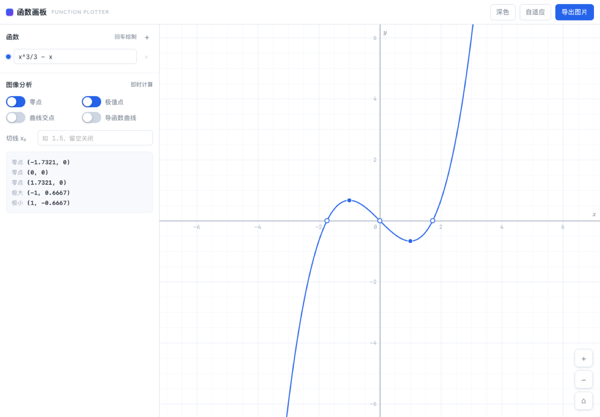

# Function Plotter

A single-file, dependency-free plotting board for mathematical functions and their analysis.

[简体中文](README.zh-CN.md)


## Overview

Function Plotter renders graphs of single-variable functions and computes their analytical properties — roots, extrema, intersections, derivative curves, and tangent lines — without a build step, runtime dependencies, or network requests.

The complete application is one HTML file of approximately 57 KB. It runs from the local filesystem, from any static host, or as a packaged macOS application. All analysis is numerical rather than symbolic: results are computed to a tolerance, not derived in closed form.

## Features

### Plotting

- Up to 8 independent curves, each with an individual colour and visibility toggle
- Zoom via scroll wheel or trackpad pinch, pan by dragging, one-click auto-fit
- Grid spacing selected automatically from the 1 / 2 / 5 × 10ⁿ series
- Live coordinate readout on pointer hover
- Discontinuities are detected and broken: `1/x` and `tan(x)` render as separate branches rather than vertical lines

### Analysis

| Feature | Method |
|---|---|
| Roots | Sign-change scan over the viewport, refined by bisection |
| Extrema | Local extremum scan, refined by golden-section search |
| Curve intersections | Root-finding applied to the difference of two functions |
| Derivative curve | Central finite difference, drawn as a dashed overlay |
| Tangent at a point | Numerical derivative, evaluated in point-slope form |

Root-finding rejects poles: after bisection converges, a point is discarded if the function value exceeds 10⁶, which prevents `1/x` from reporting a spurious root at the origin.

### Interface

- Light and dark themes, following the system preference by default
- PNG export at 2× device pixel ratio
- Responsive layout, including phone-width viewports

## Requirements

The web build targets browsers with Canvas 2D, Pointer Events, and `ResizeObserver` support:

- Safari 13.1+
- Chrome 84+
- Firefox 78+

Internet Explorer is not supported. The macOS build requires macOS 12 or later.

## Usage

### Web

Open `index.html` directly, or serve the directory over HTTP:

```bash
python3 -m http.server 8000
```

Then visit `http://localhost:8000`.

Serving over HTTP is recommended. Some browsers restrict Web Storage on `file://` origins; the application degrades gracefully in that case, but theme preference will not persist.

### macOS

Download `function-plotter-<version>.dmg` from [Releases](../../releases) and drag the application into `/Applications`.

> **Gatekeeper notice.** Builds are ad-hoc signed and not notarised, because notarisation requires a paid Apple Developer account. On first launch macOS may report that the developer cannot be verified. Right-click the application and select *Open*, or allow it under *System Settings → Privacy & Security*.

The macOS application is a WebKit shell around the same `index.html`. It contains no plotting or analysis logic of its own.



## Expression syntax

| Category | Supported |
|---|---|
| Operators | `+` `-` `*` `/` `^` `( )` |
| Implicit multiplication | `2x`, `3sin(x)`, `(x+1)(x-1)`, `x(x+2)` |
| Trigonometric | `sin` `cos` `tan` `asin` `acos` `atan` `atan2` |
| Hyperbolic | `sinh` `cosh` `tanh` |
| Exponential / logarithmic | `exp` `ln` `log` (base 10) `log2` `sqrt` `cbrt` `pow` |
| Rounding and sign | `abs` `floor` `ceil` `round` `trunc` `sign` `fract` |
| Multi-argument | `min(a,b)` `max(a,b)` `mod(a,b)` `sgn(x,p)` |
| Constants | `pi` `tau` `e` |
| Step | `step(x)` — 1 when x ≥ 0, usable for interval restriction |

The tokenizer normalises common mathematical notation, so the following are all valid input:

```
x²        →  x^2
（x+1）   →  (x+1)
x×2÷3     →  x*2/3
π         →  pi
√x        →  sqrt(x)
```

Identifier resolution uses longest-match against the function and constant tables. This means `sinh` is never mistaken for `sin` followed by `h`, and `sinx` is treated as a function call missing its parentheses rather than three separate variables — an explicit error is raised instead of a silent misparse.

Suggested expressions for exercising the engine: `1/(1+exp(-8x))`, `x*sin(1/x)`, `tan(x)`, `min(sin(x),cos(x))`.

## Keyboard shortcuts

| Key | Action |
|---|---|
| `F` | Fit view to the visible curves |
| `R` | Reset to origin at default scale |
| `+` / `-` | Zoom in / out |

## Project layout

```
index.html              All application logic (shared by the web and macOS builds)
tests/engine.test.js    Engine unit tests, 106 assertions
macos/
  Sources/main.swift    Application shell: window, menus, first-frame fallback
  Sources/Scheme.swift  fp:// resource scheme (shared by shell and test)
  verify/main.swift     Offscreen smoke test
  make-icon.swift       Procedural icon generation
  build.sh              Builds the .app bundle
  package.sh            Produces DMG / PKG and checksums
  version.env           Single source of truth for the version number
docs/                   Screenshots referenced by this document
```

One rule governs the split: **feature work happens only in `index.html`**. The macOS shell contains no algorithm, so the two distributions cannot diverge in behaviour.

## Extending

### Adding a mathematical function

Functions are declared in the `FUNCS` table near the top of `index.html`:

```js
const FUNCS = {
  sin: Math.sin,
  cos: Math.cos,
  // ...
  csch: x => 1 / Math.sinh(x),
};
```

A single entry is sufficient. The tokenizer resolves names by longest match against `FUNCS` and `CONSTS`, so `csch(x)` becomes callable immediately, including under implicit multiplication (`2csch(x)`).

Constants belong in `CONSTS`. Any identifier absent from both tables is treated as a variable; since only `x` is defined, such an expression is rejected at parse time with an explicit error rather than evaluating to NaN.

### Adding an analysis feature

Four locations are involved:

1. **`Numeric`** — implement the computation. The module already exposes `roots`, `extrema`, `intersections`, `derivative`, and `bisect`; reuse these rather than re-deriving them.
2. **`App.analysis`** — add a boolean flag for the feature.
3. **Markup** — add a checkbox to the `.an-grid` block with a unique `id`.
4. **`bindUi`** — map the new `id` to the flag in the `map` object, then draw the result inside `draw()`.

Switch styling is driven by a `.on` class that `setSwitch()` applies alongside the `checked` property. Do not rely on `:checked` alone: WebKit does not consistently recompute styles for controls with `appearance: none`, even though the selector still matches.

### Using the engine standalone

`Expr`, `Viewport`, and `Numeric` are exposed as `window.FunctionPlot`. None of them touch the DOM.

```js
const { Expr, Numeric } = window.FunctionPlot;

const f = Expr.parseToFn("x^2 - 1");
f(3);                       // 8
Numeric.roots(f, -3, 3);    // [-1, 1]
Numeric.derivative(f, 3);   // ≈ 6
```

The three modules total roughly 350 lines and depend only on `Math`, so they can be copied into another project wholesale. `Expr` compiles an expression into nested closures rather than walking an AST at every sample, which is what makes repeated evaluation cheap enough for the analysis passes.

## Building the macOS application

Requires Xcode or the Command Line Tools, which provide `swiftc`. There is no Xcode project, and the IDE does not need to be opened.

```bash
bash macos/build.sh        # Universal binary (arm64 + x86_64)
bash macos/package.sh      # Build, then produce DMG / PKG and checksums
```

Output:

```
macos/build/函数画板.app
dist/function-plotter-<version>.dmg
dist/function-plotter-<version>.pkg
dist/SHA256SUMS.txt
```

The DMG is the recommended distribution format. The PKG installs to `/Applications` and exists as an alternative for managed environments.

## Testing

```bash
node tests/engine.test.js
```

106 assertions covering expression parsing, notation normalisation, viewport transforms, sampling discontinuities, root finding, extrema, intersections, and numerical differentiation. No dependencies are required; the system Node is sufficient.

Two assertions exist specifically to prevent known failure modes:

- `1/x` changes sign across the origin and must **not** be reported as a root
- every asymptote of `tan(x)` must split the curve into independent branches, never a vertical line

The macOS shell has a separate offscreen smoke test. It opens no window and does not appear in the Dock:

```bash
cd macos
swiftc -swift-version 5 -O -o build/verify verify/main.swift Sources/Scheme.swift
./build/verify "build/函数画板.app/Contents/Resources" build/verify-shot.png
```

It loads the `fp://` scheme, checks for a fatal-error banner, confirms canvas allocation, verifies that analysis output was produced and that switch styling resolves correctly, then saves a rendered snapshot for inspection.

## Scope

The following are deliberate exclusions, not unfinished work:

- Single variable `x` only. Parametric, polar, and implicit curves are not supported.
- Numerical analysis only. No symbolic differentiation or integration.
- No animation, moving points, or trace recording.
- No persistence. Reloading resets the board.
- No server component, account system, or telemetry.

Requests outside this scope are unlikely to be implemented. The value of the project lies in doing two things — plotting functions and analysing them — without the surface area that usually accompanies them.

## Maintenance

This is a personal project, maintained in spare time.

- Issues are read, but may not receive a timely reply.
- Feature requests are not guaranteed to be implemented; the scope above is intentional.
- Bug reports are most useful when they include the exact expression entered, the expected result, and the observed result.
- Pull requests are welcome for bug fixes, documentation, additional mathematical functions, and test cases.

## License

[MIT](LICENSE). Commercial use is permitted.
