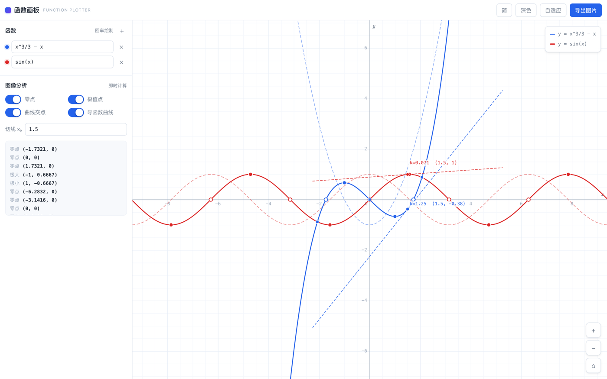
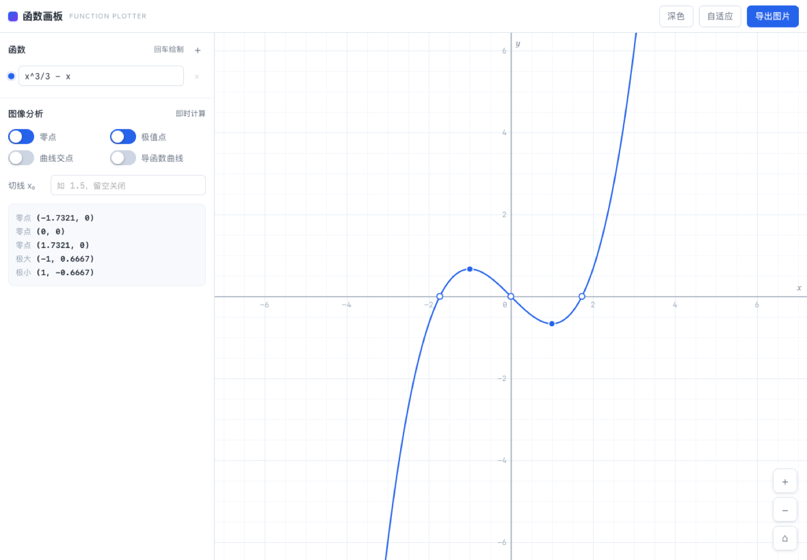

# 函数画板

一个只做函数图像与图像分析的单文件画板，零依赖。

[English](README.md)



## 概述

函数画板绘制一元函数图像，并计算其解析性质——零点、极值、交点、导函数曲线、指定点切线——无需构建步骤、运行时依赖或网络请求。

完整应用为一个约 57 KB 的 HTML 文件，可从本地文件系统、任意静态托管或打包后的 macOS 应用运行。全部分析采用数值方法而非符号推导：结果为在给定容差内收敛的近似值，不给出闭式表达。

## 功能

### 绘图

- 最多 8 条独立曲线，各自具备独立配色与显隐开关
- 滚轮或触控板捏合缩放，拖拽平移，一键自适应
- 网格步长按 1 / 2 / 5 × 10ⁿ 序列随缩放级别自动选取
- 指针悬停显示实时坐标读数
- 间断点自动识别并断开：`1/x` 与 `tan(x)` 渲染为独立分支，不产生竖直连线

### 图像分析

| 功能 | 方法 |
|---|---|
| 零点 | 视口内变号扫描，二分法精化 |
| 极值点 | 局部极值扫描，黄金分割精化 |
| 曲线交点 | 对两函数之差求根 |
| 导函数曲线 | 中心差分，以虚线叠加显示 |
| 指定点切线 | 数值导数，点斜式求值 |

求根过程会排除极点：二分收敛后，若函数值超过 10⁶ 则判定该点无效。缺少此判据时，`1/x` 会在原点处被误报为零点。

### 界面

- 界面语言：英文、简体中文、繁体中文。首次启动跟随系统语言，手动选择后记住
- 深色与浅色主题，默认跟随系统外观
- PNG 导出，按 2 倍设备像素比渲染
- 响应式布局，支持手机宽度视口

## 运行环境

网页版面向支持 Canvas 2D、Pointer Events 与 `ResizeObserver` 的浏览器：

- Safari 13.1 及以上
- Chrome 84 及以上
- Firefox 78 及以上

不支持 Internet Explorer。macOS 版要求 macOS 12 及以上。

## 使用方式

### 网页

直接打开 `index.html`，或通过 HTTP 提供该目录：

```bash
python3 -m http.server 8000
```

随后访问 `http://localhost:8000`。

建议通过 HTTP 访问。部分浏览器对 `file://` 来源限制 Web Storage；应用在此情况下会降级运行，但主题偏好无法持久化。

### macOS

从 [Releases](../../releases) 下载 `function-plotter-<版本>.dmg`，将应用拖入 `/Applications`。

> **关于 Gatekeeper 提示。** 构建产物为 ad-hoc 签名、未经公证，因为公证需要付费的 Apple Developer 账号。首次启动时 macOS 可能提示无法验证开发者。右键点击应用并选择「打开」，或在「系统设置 → 隐私与安全性」中放行。

macOS 应用是同一份 `index.html` 的 WebKit 外壳，自身不包含任何绘图或分析逻辑。



## 表达式语法

| 类别 | 支持内容 |
|---|---|
| 运算符 | `+` `-` `*` `/` `^` `( )` |
| 隐式乘法 | `2x`、`3sin(x)`、`(x+1)(x-1)`、`x(x+2)` |
| 三角函数 | `sin` `cos` `tan` `asin` `acos` `atan` `atan2` |
| 双曲函数 | `sinh` `cosh` `tanh` |
| 指数与对数 | `exp` `ln` `log`（常用对数）`log2` `sqrt` `cbrt` `pow` |
| 取整与符号 | `abs` `floor` `ceil` `round` `trunc` `sign` `fract` |
| 多参数 | `min(a,b)` `max(a,b)` `mod(a,b)` `sgn(x,p)` |
| 常量 | `pi` `tau` `e` |
| 阶跃 | `step(x)` — 当 x ≥ 0 时取 1，可用于截取区间 |

词法分析阶段会对常见数学符号做归一化，因此下列写法均为合法输入：

```
x²        →  x^2
（x+1）   →  (x+1)
x×2÷3     →  x*2/3
π         →  pi
√x        →  sqrt(x)
```

标识符解析对函数表与常量表做最长匹配。因此 `sinh` 不会被误拆为 `sin` 与 `h`；`sinx` 会被判为缺少括号的函数调用并抛出明确错误，而非被静默误解析为三个变量。

可用于检验引擎的表达式：`1/(1+exp(-8x))`、`x*sin(1/x)`、`tan(x)`、`min(sin(x),cos(x))`。

## 键盘快捷键

| 按键 | 作用 |
|---|---|
| `F` | 自适应至可见曲线 |
| `R` | 复位到默认比例的原点视图 |
| `+` / `-` | 放大 / 缩小 |

## 项目结构

```
index.html              全部应用逻辑（网页版与 macOS 版共用）
tests/engine.test.js    引擎单元测试，106 项断言
macos/
  Sources/main.swift    应用外壳：窗口、菜单、首帧兜底
  Sources/Scheme.swift  fp:// 资源协议（外壳与测试共用）
  verify/main.swift     离屏冒烟测试
  make-icon.swift       程序化图标生成
  build.sh              构建 .app
  package.sh            产出 DMG / PKG 与校验和
  version.env           版本号唯一来源
docs/                   本文档引用的截图
```

分工遵循一条规则：**功能改动只发生在 `index.html`**。macOS 外壳不含任何算法，因此两种分发形态不存在行为分叉的可能。

## 扩展

### 新增数学函数

函数声明位于 `index.html` 顶部的 `FUNCS` 表中：

```js
const FUNCS = {
  sin: Math.sin,
  cos: Math.cos,
  // ...
  csch: x => 1 / Math.sinh(x),
};
```

增加一条表项即可。词法分析对 `FUNCS` 与 `CONSTS` 做最长匹配，`csch(x)` 会立即可用，隐式乘法（`2csch(x)`）同样生效。

常量应加入 `CONSTS`。未出现在任一张表中的标识符会被当作变量处理；由于仅定义了 `x`，此类表达式在解析阶段即抛出明确错误，而非求值为 NaN。

### 新增分析功能

涉及四处修改：

1. **`Numeric`** — 实现计算。该模块已提供 `roots`、`extrema`、`intersections`、`derivative` 与 `bisect`，应复用而非重新推导。
2. **`App.analysis`** — 新增对应的布尔标志。
3. **标记结构** — 在 `.an-grid` 区块内增加一个 checkbox，并赋予唯一 `id`。
4. **`bindUi`** — 在 `map` 对象中登记新 `id` 与标志的映射，并在 `draw()` 内绘制结果。

开关的视觉状态由 `.on` 类驱动，`setSwitch()` 会与 `checked` 属性一并设置。不应仅依赖 `:checked`：对于 `appearance: none` 的控件，WebKit 不会稳定地重算样式，尽管选择器本身仍然匹配。

### 独立使用引擎

`Expr`、`Viewport`、`Numeric` 通过 `window.FunctionPlot` 暴露，三者均不触碰 DOM。

```js
const { Expr, Numeric } = window.FunctionPlot;

const f = Expr.parseToFn("x^2 - 1");
f(3);                       // 8
Numeric.roots(f, -3, 3);    // [-1, 1]
Numeric.derivative(f, 3);   // ≈ 6
```

三个模块合计约 350 行，仅依赖 `Math`，可整体复制到其他项目。`Expr` 将表达式编译为嵌套闭包，而非在每次采样时遍历语法树，这是分析过程中高频求值仍然廉价的原因。

## 构建 macOS 应用

需要 Xcode 或提供 `swiftc` 的 Command Line Tools。项目不使用 Xcode 工程，无需打开 IDE。

```bash
bash macos/build.sh        # 通用二进制（arm64 + x86_64）
bash macos/package.sh      # 构建，随后产出 DMG / PKG 与校验和
```

产物：

```
macos/build/函数画板.app
dist/function-plotter-<版本>.dmg
dist/function-plotter-<版本>.pkg
dist/SHA256SUMS.txt
```

推荐以 DMG 分发。PKG 安装至 `/Applications`，作为受管环境下的备选方案。

## 测试

```bash
node tests/engine.test.js
```

106 项断言，覆盖表达式解析、符号归一化、视口变换、采样断点、求根、求极值、求交与数值微分。无需安装依赖，系统 Node 即可运行。

其中两项断言针对已知失效模式：

- `1/x` 在原点两侧变号，**不得**被判定为零点
- `tan(x)` 的每条渐近线都必须把曲线切分为独立分支，不得连成竖线

macOS 外壳另有一套离屏冒烟测试，不打开窗口，不占用 Dock：

```bash
cd macos
swiftc -swift-version 5 -O -o build/verify verify/main.swift Sources/Scheme.swift
./build/verify "build/函数画板.app/Contents/Resources" build/verify-shot.png
```

该测试加载 `fp://` 协议、检查是否存在致命错误横幅、确认 canvas 已分配像素、验证分析结果已产出且开关配色正确，最后保存一张渲染快照供人工核对。

## 范围界定

以下为有意的排除项，不属于未完成的功能：

- 仅支持单变量 `x`。不支持参数方程、极坐标与隐函数曲线。
- 仅做数值分析。不提供符号求导与符号积分。
- 无动画、动点与轨迹记录。
- 无持久化。刷新后画板状态重置。
- 无服务端、账号体系与任何埋点。

超出此范围的请求预计不会被实现。本项目的价值在于把「绘制函数」与「分析函数」两件事做完整，而不附带通常与之相伴的功能面积。

## 维护说明

本项目为个人项目，以业余时间维护。

- Issue 会被阅读，但不保证及时回复。
- 功能请求不保证实现；上文的范围界定是有意的。
- Bug 报告的有效性取决于是否包含三项信息：实际输入的表达式、期望结果、实际结果。
- 欢迎针对缺陷修复、文档、新增数学函数与测试用例的 Pull Request。

## 许可证

[MIT](LICENSE)。允许商业使用。
